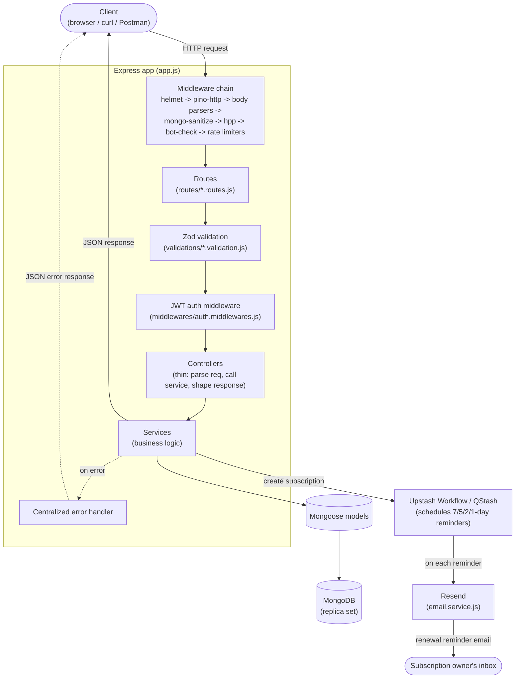

# Subscription Tracker API


A Node.js/Express REST API for tracking recurring subscriptions — user auth, subscription CRUD, automatic renewal-date calculation, and scheduled renewal reminders via Upstash Workflow/QStash.

## Features

- **Authentication** — signup/signin/signout with JWT, hashed passwords (bcrypt), and a transactional signup (MongoDB session) to guarantee atomic user creation.
- **Subscriptions** — create subscriptions with a `startDate` and `frequency`; `renewalDate` is auto-calculated on save if not provided, and `status` auto-flips to `expired` once the renewal date has passed.
- **Renewal reminders** — creating a subscription can trigger an Upstash Workflow run that schedules reminders 7/5/2/1 days before renewal, sent as real emails via [Resend](https://resend.com) (free tier — see Prerequisites for its sandbox-sender limitation).
- **Security middleware** — self-hosted stack: `helmet` (secure headers), `express-rate-limit` (general + stricter auth rate limiting), `express-mongo-sanitize` (NoSQL injection protection), `hpp` (HTTP parameter pollution protection), and a small custom check that rejects requests with a missing or known-scanner User-Agent.
- **Request validation** — Zod schemas validate every write endpoint's body; invalid requests get a `400` with per-field error details.
- **Centralized error handling** — Mongoose `CastError`, duplicate-key, and validation errors (both Mongoose's and Zod's) are normalized into consistent JSON error responses.
- **Structured logging** — every request/response is logged as structured JSON via `pino`/`pino-http` (pretty-printed and colorized outside production); a `GET /health` endpoint reports process uptime and database connectivity without generating log noise.
- **Tested** — Jest + Supertest suite covering auth flows, subscription CRUD, and the renewal-date calculation logic, run against an in-memory MongoDB.
- **API docs** — a full OpenAPI 3.0 spec (validated), served as interactive Swagger UI at `/api-docs`.

## Architecture



Request flow for a typical write (e.g. `POST /api/v1/subscriptions`): security middleware runs first and can short-circuit the request (rate limit, bad User-Agent, NoSQL-injection payload) before it ever reaches a route; Zod validation rejects a malformed body with a `400` before any database call; the JWT auth middleware resolves `req.user` before ownership checks in the service layer can run; the service is the only layer that talks to Mongoose models, keeping controllers thin and testable in isolation.

## Tech Stack

- **Runtime**: Node.js (ESM / `"type": "module"`)
- **Framework**: Express 4
- **Database**: MongoDB with Mongoose 8
- **Auth**: jsonwebtoken, bcryptjs, cookie-parser
- **Security**: helmet, express-rate-limit, express-mongo-sanitize, hpp
- **Validation**: Zod
- **Logging**: pino, pino-http (pino-pretty in development)
- **Scheduling**: @upstash/workflow (QStash)
- **Email**: Resend
- **Dates**: dayjs
- **Testing**: Jest, Supertest, mongodb-memory-server
- **API docs**: swagger-ui-express (spec at `docs/openapi.js`, validated with `@apidevtools/swagger-parser`)
- **Tooling**: ESLint, nodemon

## Prerequisites

- Node.js and npm — or Docker + Docker Compose if you'd rather skip installing Node/MongoDB locally (see Running with Docker below)
- A MongoDB connection string (not needed if using Docker Compose, which provides its own)
    - Signup uses a Mongoose transaction, so the database must be a **replica set** (any MongoDB Atlas cluster satisfies this by default; a plain standalone `mongod` does not).
- An [Upstash QStash](https://upstash.com/docs/qstash) token + URL (used to schedule renewal reminders)
- A [Resend](https://resend.com) API key (free tier, no card required — used to send renewal reminder emails)
    - **Sandbox limitation**: without verifying your own domain, Resend's free sandbox sender (`onboarding@resend.dev`) can only deliver to the email address your Resend account itself was signed up with — not to arbitrary subscriber emails. Fine for demonstrating the feature; verify a domain (still free) if you want it to email real recipients.

## Installation

```bash
npm install
```

## Configuration

Environment variables are loaded from `.env.<NODE_ENV>.local` (see `config/env.js`), defaulting to `.env.development.local` when `NODE_ENV` is unset. Create that file in the project root with:

```bash
PORT=5500
SERVER_URL=<your server's public URL, e.g. an ngrok tunnel in dev>
NODE_ENV=development

DB_URI=<your MongoDB connection string>

JWT_SECRET=<your JWT signing secret>
JWT_EXPIRES_IN=1d

QSTASH_URL=https://qstash.upstash.io
QSTASH_TOKEN=<your Upstash QStash token>

RESEND_API_KEY=<your Resend API key>
# Optional: overrides the default sandbox sender once you've verified your own domain
RESEND_FROM_EMAIL=Subscription Tracker <reminders@yourdomain.com>

# Optional: overrides the default log level (debug in development, info in production)
LOG_LEVEL=debug
```

If `RESEND_API_KEY` isn't set, renewal reminder emails are skipped with a logged warning instead of crashing the app — useful if you want to run everything else without setting up Resend yet.

For a production deployment, create `.env.production.local` with the equivalent production values (`NODE_ENV=production` enables the renewal-reminder workflow trigger automatically on subscription creation).

## Usage

```bash
npm run dev    # start with nodemon (auto-restart on changes)
npm start      # start normally
```

The API listens on `http://localhost:<PORT>` and connects to MongoDB on startup.

## Running with Docker

For local one-command setup — this is for packaging/portability, not a deployment guide:

```bash
docker compose up --build
```

This builds the app image and starts two services:

- **`mongo`** — a single-node MongoDB replica set (required, not optional: signup and delete-user use Mongoose transactions, which a plain standalone `mongod` doesn't support). A one-shot `mongo-init` job initializes the replica set automatically the first time; the `app` service waits for it to finish before starting.
- **`app`** — the API, built from the `Dockerfile`, listening on `http://localhost:5500`.

No `.env` file is required to get it running — `docker-compose.yml` ships with safe local-only defaults (a placeholder `JWT_SECRET`, etc.) and Upstash/Resend simply stay inactive (already handled gracefully — see Testing) if left unconfigured. To use real QStash/Resend credentials inside Docker, create a `.env` file next to `docker-compose.yml` (Compose loads it automatically) with any of:

```bash
JWT_SECRET=<something less obviously a placeholder>
QSTASH_URL=https://qstash.upstash.io
QSTASH_TOKEN=<your Upstash QStash token>
RESEND_API_KEY=<your Resend API key>
RESEND_FROM_EMAIL=<your verified sender>
```

Verify it's working:

```bash
curl http://localhost:5500/health
```

Tear down with `docker compose down` (add `-v` to also delete the Mongo data volume).

## Testing

```bash
npm test
```

Runs the Jest + Supertest suite (`tests/`) against an in-memory MongoDB (via `mongodb-memory-server` — no real database or network access needed). Covers:

- **Auth flows** — signup (success, duplicate email, invalid payload), signin (success, wrong password, unknown email), signout.
- **Subscription CRUD** — create/list/get/update/cancel/delete, ownership enforcement (403 on another user's subscription), validation rejection, `upcoming-renewals` filtering.
- **Renewal-date calculation** — the `Subscription` model's pre-save hook: auto-calculating `renewalDate` per `frequency`, not overriding an explicitly provided `renewalDate`, flipping `status` to `expired` only from `active`, and never clobbering an explicit `cancelled` status.

Config comes from `.env.test.local`, which (unlike your other `.env.*.local` files) is committed — it holds only fixed dummy values (a fake JWT secret, a fake QStash token), never real credentials.

## Continuous Integration

[.github/workflows/ci.yml](.github/workflows/ci.yml) runs on every pull request and push to `main`: `lint` (`npx eslint .`), `test` (`npm test`), and `validate-openapi` (`npm run validate:openapi`) — three jobs in parallel, each against a clean `npm ci` install on Node 20. No secrets or external services are needed — the test job uses the same in-memory MongoDB and committed `.env.test.local` as local `npm test`.

## API Documentation

Interactive Swagger UI is served at [`/api-docs`](http://localhost:5500/api-docs) once the server is running — every endpoint below, with request/response schemas and a "try it out" console (paste a JWT into the Authorize button to hit protected routes). The underlying OpenAPI 3.0 spec lives in [docs/openapi.js](docs/openapi.js) and is validated with `@apidevtools/swagger-parser` before being trusted.

## API Endpoints

`GET /health` (not under `/api/v1`) reports `{ status, uptime, timestamp, database }` and is exempt from rate limiting, the bot-check, and request logging, since infra health probes shouldn't be throttled or spam the logs.

All other routes are prefixed with `/api/v1`.

### Auth (`/auth`)

| Method | Endpoint   | Description                  |
| ------ | ---------- | ---------------------------- |
| POST   | `/signup`  | Create a user, returns a JWT |
| POST   | `/signin`  | Authenticate, returns a JWT  |
| POST   | `/signout` | Sign out                     |

### Subscriptions (`/subscriptions`)

| Method | Endpoint                    | Auth     | Description                                                          |
| ------ | --------------------------- | -------- | -------------------------------------------------------------------- |
| GET    | `/`                         | required | List the authenticated user's subscriptions                          |
| GET    | `/upcoming-renewals`        | required | Active subscriptions renewing within `?days=` (default 7)            |
| GET    | `/user/:id`                 | required | Get a given user's subscriptions (must match the authenticated user) |
| GET    | `/:subscriptionId/workflow` | required | Get the Upstash workflow status for a subscription's reminders       |
| GET    | `/:id`                      | required | Get subscription details (owner only)                                |
| POST   | `/`                         | required | Create a subscription                                                |
| PUT    | `/:id`                      | required | Update a subscription (owner only)                                   |
| DELETE | `/:id`                      | required | Delete a subscription (owner only)                                   |
| PUT    | `/:id/cancel`               | required | Cancel a subscription (owner only)                                   |

### Users (`/users`)

| Method | Endpoint | Auth     | Description                                                 |
| ------ | -------- | -------- | ----------------------------------------------------------- |
| GET    | `/`      | required | List all users (passwords excluded)                         |
| GET    | `/:id`   | required | Get a user by id                                            |
| POST   | `/`      | —        | Create a user                                               |
| PUT    | `/:id`   | required | Update a user (self only)                                   |
| DELETE | `/:id`   | required | Delete a user (self only) — cascades to their subscriptions |

### Workflows (`/workflows`)

| Method | Endpoint                  | Description                                                                                                                                |
| ------ | ------------------------- | ------------------------------------------------------------------------------------------------------------------------------------------ |
| POST   | `/subscriptions/reminder` | Upstash Workflow entry point that runs the renewal-reminder schedule; triggered internally by QStash, not intended for direct client calls |

Authenticated routes expect `Authorization: Bearer <token>`.

## Project Structure

```
backend/
├── .github/workflows/ci.yml      # lint + test + validate-openapi on every PR / push to main
├── app.js                        # Express app definition (middleware + routes) -- no listen/DB connect, so tests can import it cleanly
├── server.js                     # Actual process entry point: starts listening and connects to MongoDB
├── jest.config.js                # Jest config (native ESM, no transform)
├── Dockerfile                    # Builds the app image (node:20-alpine, prod deps only, non-root)
├── docker-compose.yml            # app + a single-node Mongo replica set, for one-command local setup
├── .dockerignore
├── docs/
│   └── openapi.js                # Hand-written OpenAPI 3.0 spec, served via swagger-ui-express at /api-docs
├── scripts/
│   └── validate-openapi.js       # Validates docs/openapi.js with @apidevtools/swagger-parser (npm run validate:openapi)
├── config/
│   ├── env.js                    # Loads env vars from .env.<NODE_ENV>.local
│   ├── logger.js                 # pino logger (pretty-printed outside production, silent in tests)
│   ├── resend.js                 # Lazily-constructed Resend client (null if RESEND_API_KEY unset)
│   └── upstash.js                # Upstash Workflow client
├── controllers/                  # Thin: parse req, call a service, shape the response
│   ├── auth.controller.js
│   ├── subscription.controller.js
│   ├── user.controller.js
│   └── workflow.controller.js    # Upstash Workflow definition: schedules + sends renewal reminder emails
├── services/                     # Business logic + Mongoose calls
│   ├── auth.service.js
│   ├── email.service.js          # Sends renewal reminder emails via Resend
│   ├── subscription.service.js
│   └── user.service.js
├── validations/                  # Zod schemas for write-endpoint request bodies
│   ├── auth.validation.js
│   ├── subscription.validation.js
│   └── user.validation.js
├── utils/
│   └── sanitize.js                # withoutPassword() -- strips the password hash before a user doc leaves a service
├── database/
│   └── mongodb.js                # Mongoose connection
├── middlewares/
│   ├── auth.middlewares.js       # JWT verification
│   ├── error.middleware.js       # Centralized error handler
│   ├── security.middlewares.js   # Rate limiting + bot/User-Agent check (helmet/mongo-sanitize/hpp wired in app.js)
│   └── validate.middlewares.js   # Zod request-body validation middleware factory
├── models/
│   ├── subscription.model.js
│   └── user.model.js
├── routes/
│   ├── auth.routes.js
│   ├── subscription.routes.js
│   ├── users.routes.js
│   └── workflow.routes.js
└── tests/
    ├── setup.js                  # Starts/stops the in-memory MongoDB replica set for each test file
    ├── request.js                # Supertest wrapper that sets a User-Agent (see botCheck middleware)
    ├── helpers.js                # Shared test helpers (e.g. registering a user)
    ├── auth.test.js
    ├── subscription.test.js
    └── renewal-date.test.js
```

## Linting

```bash
npx eslint .
```
